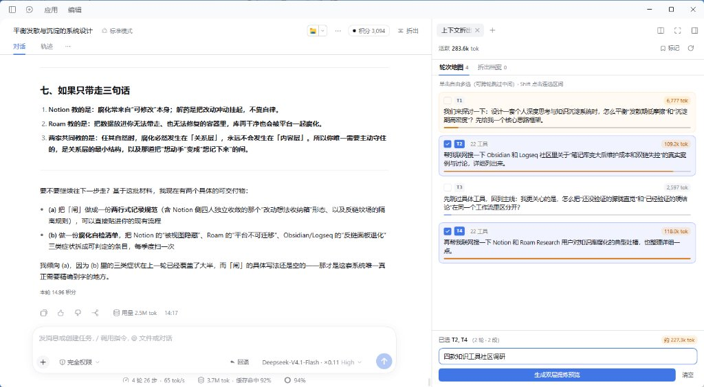
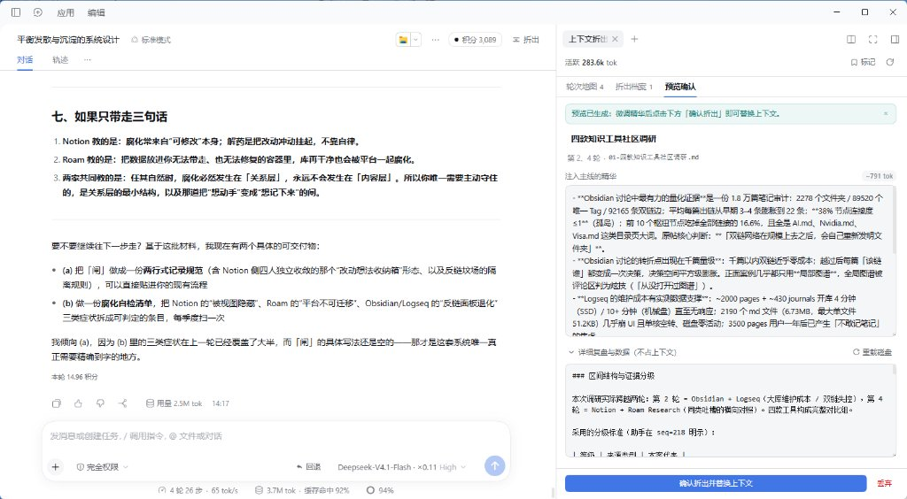
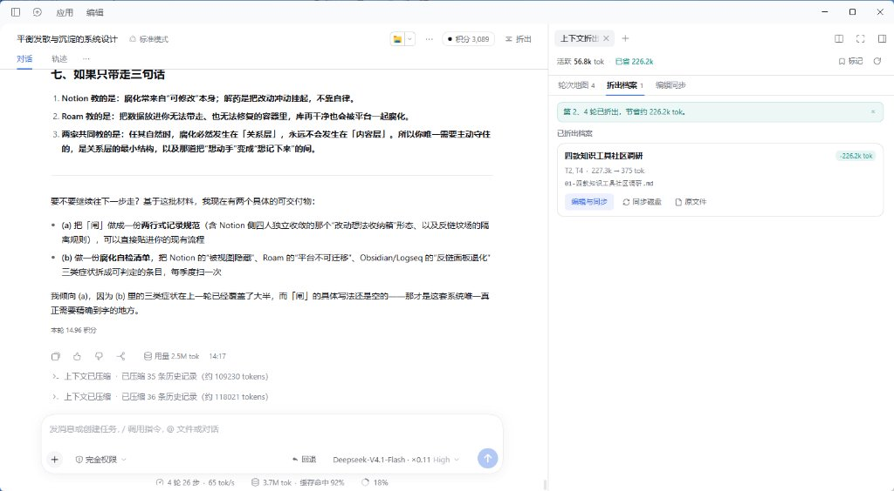

# dsh-context-fold

> **把长对话从“越聊越钝”变成“越聊信息密度越高”。**  
> DeepSeek Harness（DSH）的**局部上下文折出 + 双层可编辑档案 + 原地热同步**插件。

---

## 实测效果：单次将上下文从 `94%` 降到 `18%`

在一场穿插了两轮重度联网调研的 4 轮对话中，只勾选两轮高消耗验证（`T2` + `T4`），保留中间主线思考（`T1`、`T3`），一次折出净省 **`226.2k tokens`**，屏幕原对话一字不删：

### 1. 跨轮自由多选，精准跳过中间主线
当前活跃上下文已达 **`283.6k tok`（底部占用 `94%`）**。在右侧「轮次地图」中只勾选了 `T2`（`109.2k tok` · 22 次工具调用）和 `T4`（`118.0k tok` · 22 次工具调用），跳过 `T1` 和 `T3` 主线思考：



### 2. 双层可编辑 Markdown 预览，折出前先过目微调
后台自动提炼出 `01-四款知识工具社区调研.md`：**上方「注入主线的精华」** 可直接删改，只保留真正想留给模型的高信噪比结论；**下方「详细复盘与数据」** 落盘归档，不占模型上下文：



### 3. 确认折出：上下文 `94% → 18%`，随时编辑原地热同步
点击确认后，活跃上下文从 **`283.6k tok` 降至 `56.8k tok`**（底部原生进度环 **`94% → 18%`**，净省 **`226.2k tok`**）；左侧完整对话记录原样保留，右侧随时可点「编辑与同步」「同步磁盘」或打开原 `.md` 文件：



---

## 为什么做这个插件？

如果你经常用 AI 做**深度思考、方案推演、投研复盘或复杂排错**，一定遇到过这四个让人抓狂的瞬间：

1. **越聊模型越跟不上，甚至前后矛盾，但你舍不得新开对话**  
   长对话聊到后面，穿插了大量数据验证、网页抓取和试错过程，模型注意力明显下降、开始跟前面自相矛盾——但你不想新开冷冰冰的空对话，因为当前对话里沉淀下来的**氛围、语境和灵感连贯性**很珍贵。
2. **黑盒自动压缩不可控，还容易把分歧“洗成假共识”**  
   普通压缩是一个黑盒：你不知道它压掉了哪句关键直觉，也改不了它的理解；更糟的是，模型为了写出“连贯摘要”，常常把你们还没谈拢的分歧、甚至已经聊歪的议题，悄悄改写成“已确定结论”。
3. **传统分支“只分不合”，越聊越回不去**  
   开分支去验证一个小点，结果分支里聊出了好东西——切回原对话，主线完全不知道你刚才验了什么；留在分支里继续聊，分支又背着几万 Token 的验证过程滚雪球，失去了开分支的意义。
4. **长对话里的顺从惯性，自己审自己审不出问题**  
   在又长又糊的同一条对话流里，模型很容易顺着前面的惯性和双方偏好继续编造看似自洽的错误结构，很难跳出来反向审视。

---

## 它怎么解决？

`dsh-context-fold` 不逼你搬家开新会话，也不搞黑盒一刀切压缩，而是让你在**同一个对话里不断验证、不断剥离噪音、不断精炼沉淀**：

- **自由跨轮多选，跳过中间主线**  
  在右侧「轮次地图」里一眼看出每轮消耗了多少 Token 和工具调用；**单击自由勾选任意分散轮次**（如只折出 `T2` 和 `T5`，中间 `T3–T4` 主线思路纹丝不动），也支持 **`Shift` 连选区间** 或先打 **起点标记**。
- **双层可编辑 Markdown 档案**  
  点击折出后，后台自动提炼成一份保存在工作区 `.dsh-folds/` 下的双层文档，并在你确认前提供可视化编辑预览：
  - `## 注入主线的精华`（3–8 行高信噪比结论、反例、待定分歧）——**只有这部分替换进模型上下文**；
  - `## 详细复盘与数据`（完整数据、推演细节、原始过程）——**只存磁盘不占上下文**，以后需要核查时模型按需读回。
- **改完原地热同步，不刷屏、不丢原记录**  
  随时在面板内或外部编辑器修改档案里的精华，一键原地更新模型上下文里的对应节点（支持无限次同步，不给聊天流刷屏）。同时基于 DSH 原生 `surfaceOp: replace` 机制，**你屏幕上的原始聊天记录一字不删**，随时可以回翻。
- **意外收获：在原对话里获得“审视距离”**  
  把阶段性验证和讨论剥离成干净的外部摘要与档案后，模型重新审视这份精炼文本与前后主线时，能跳出原本的生成惯性，主动指出前后口径矛盾与未经证实的推断——让你在**同一个对话里持续拆矛盾、评估、修正与迭代**，让上下文的信息密度越来越高。

---

## 与现有方案的区别

| 方案 | 保留主线语境与氛围 | 精准剔除局部噪音 | 摘要可见且可反复修改 | 保留原聊天记录 |
|---|:---:|:---:|:---:|:---:|
| 自动压缩 `/compact` | 一般（易压扁主线） | 不支持（按时间线一刀切） | 仅可见、不可改 | 是 |
| 新开会话 / Handoff | 断层（冷启动） | 需手动整理 | 仅开局改一次 | 留在旧会话 |
| 传统分支（Fork） | 分出去就难合回 | 支线结论带不回主线 | 不支持 | 是 |
| **`dsh-context-fold`** | **完整保留** | **支持任意连续/跨轮多选** | **双层文档，无限次原地热同步** | **完整保留** |

---

## 功能一览

### 1. 右侧栏「上下文折出」可视化面板
打开任意会话，点击会话右上角工具栏的 **「折出」** 按钮（或在右侧栏工具页选择 **「上下文折出」**）：
- **轮次地图**：按轮次展示每轮活跃 Token 占比条（自动标黄高消耗验证轮、显示工具调用次数），单击自由多选、Shift 连选区间，点击已折出轮次可直接跳转编辑对应档案。
- **起点标记**：开始拉数据验证或排查前点 `标记`，验完一键选中整段验证区间。
- **预览确认与内联编辑**：折出前先审阅和微调「注入主线的精华」，确认满意后再替换上下文。
- **折出档案管理**：查看每段节省的 Token，支持内联编辑同步、一键 **「同步磁盘」**（适配 VSCode / 侧栏直接改文件）、或在侧栏打开原 `.md` 文件。
- **克制流光反馈**：贴合 DSH 原生极简视觉体系（亮/暗主题自适应），在提炼、折出与同步时提供轻量的流光描边与贝塞尔飞线反馈（遵循系统减弱动效设置）。

### 2. 斜杠命令（键盘流）
- `/folds`：查看各轮 Token 分布与已折出档案
- `/mark [主题]`：打一个起点标记（如 `/mark 某股龙虎榜验证`）
- `/fold`：将最近起点标记到当前轮次提炼为可编辑草稿
- `/fold 18-32 [主题]`：将第 18–32 轮提炼为可编辑草稿
- `/fold 2,4-5,8 [主题]`：跨轮多选非连续轮次并提炼为同一份草稿
- `/fold last 8 [主题]`：将最近 8 轮提炼为可编辑草稿
- `/fold-apply [foldId]`：确认将草稿替换进模型上下文
- `/fold-sync [foldId]`：改完 Markdown 文件后，原地同步最新精华到模型上下文

---

## 安装到 DeepSeek Harness

已实测兼容 **DSH `0.2.1-rc.5`**（不改 DSH 本体、不替换内置 `dsh-compaction-basic`、零运行时第三方依赖、完整通过 DSH v4 会话持久化重启校验）。

### 方式 A：通过 GitHub 安装
1. 打开你的 DSH profile 配置文件（默认位于 `~/.dsh/profiles/desktop/package.json`），在 `dependencies` 中加入：
   ```json
   "dsh-context-fold": "github:mioakiyama0809-coder/dsh-context-fold"
   ```
   并在 `dsh.profile.bundles` 数组中加入 `"dsh-context-fold"`；
2. 在 `~/.dsh/profiles/desktop` 目录下安装依赖后，完全退出并重启 DeepSeek Harness。

### 方式 B：本地源码开发挂载
```bash
git clone https://github.com/mioakiyama0809-coder/dsh-context-fold.git
cd dsh-context-fold
npm install
npm run build
npm test
```
然后在 `~/.dsh/profiles/desktop/package.json` 中使用 `"dsh-context-fold": "file:/path/to/dsh-context-fold"`，并在 `dsh.profile.bundles` 中加入 `"dsh-context-fold"`（或在 `desktop/node_modules/dsh-context-fold` 建立软链接 / 目录联接），重启 DSH 即可生效。

> **小提示**：如果你希望完全由自己掌控长对话的沉淀节奏，可以在 `cordis.patch.yml` 里把 `@deepseek-ai/dsh-compaction-basic` 的 `auto` 设为 `false`（或把 `thresholdRatio` 调高作为兜底）。

---

## 档案目录结构

折出的文件保存在当前会话工作区的 `.dsh-folds/<sessionId>/`：
- `.dsh-folds/.gitignore`：自动生成（`*`），避免污染你的项目 Git 状态
- `01-<标题>.md`、`02-<标题>.md`：双层可编辑 Markdown 档案
- `INDEX.md`：自动维护的折出档案索引表
- `folds.json`：状态元数据

上下文中仅注入工作区相对路径，不会泄露本机绝对路径或用户名。

---

## 开发与测试

```bash
npm install
npm run build
npm test
```

## 致谢（Credits）

- 流光飞线、落地涟漪与 `1.2px` 克制流光描边动效参考并改编自 Lancer 的 `@lancer/light-ui`（Lancer contributors, 2026, MIT）及其上游项目 [pi-gui](https://github.com/minghinmatthewlam/pi-gui)（Copyright (c) 2026 Matthew Lam, MIT）。详见 [NOTICE](NOTICE)。

## License

[MIT](LICENSE)
